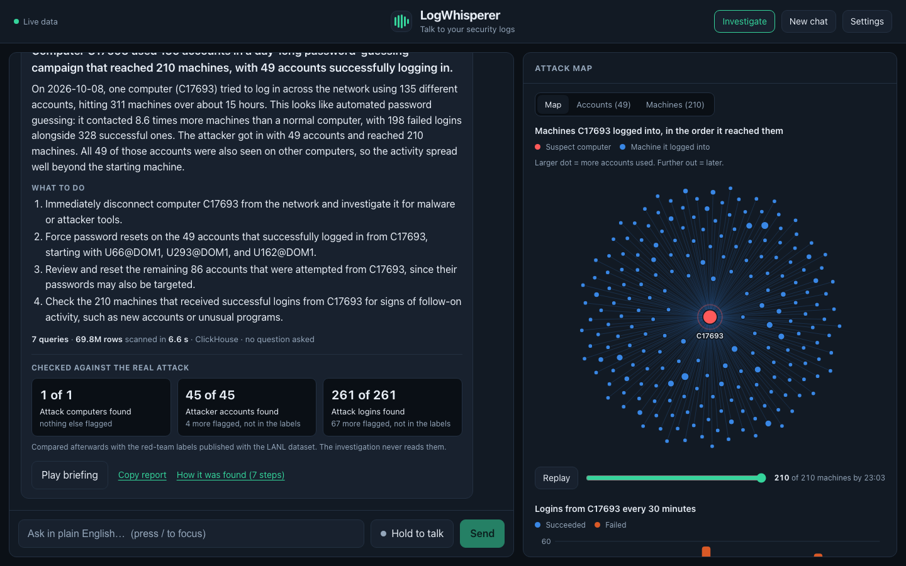
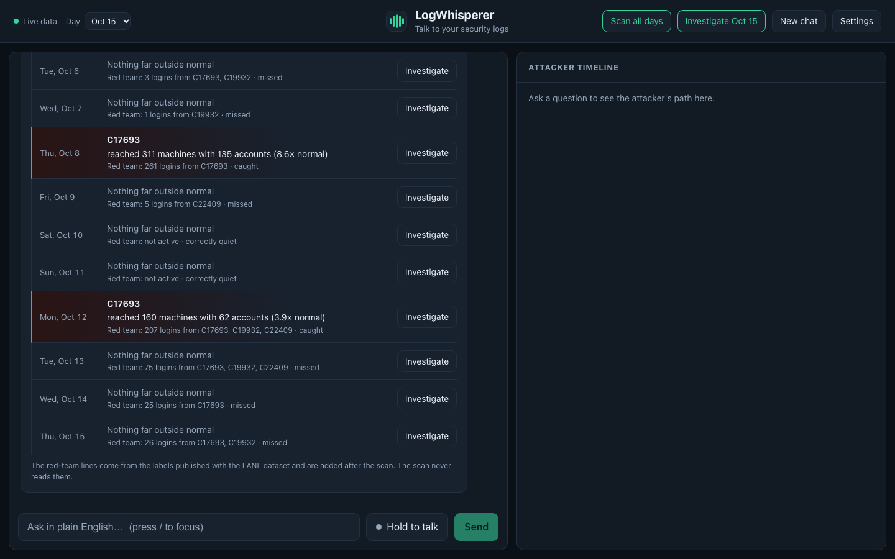
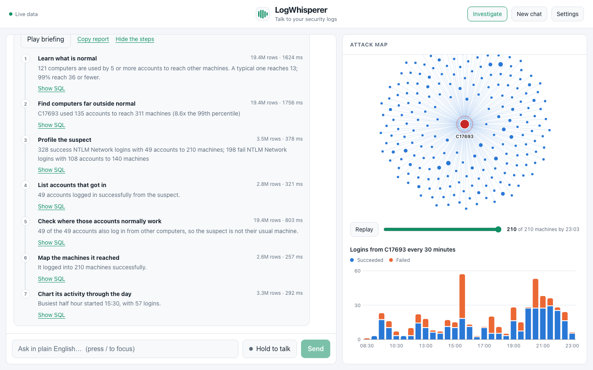
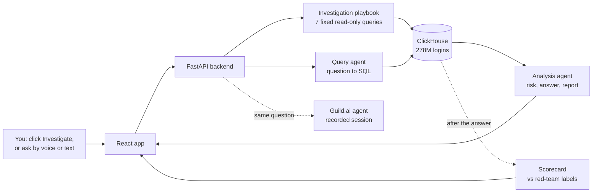

# LogWhisperer

**An AI security analyst that hunts through login logs with no hints, shows its work, and is scored against a real attack.**

Point it at 278 million real logins from Los Alamos National Laboratory and click one button. It learns what normal looks like, finds the computer an attacker was working from, lists the accounts they stole, and maps every machine they reached. Then it tells you, in plain English, what to do about it. You can also just ask it questions, by voice or by typing.



## Results

The LANL dataset includes labels for what its red team really did. LogWhisperer never reads them while investigating, so they work as an answer key. Every number below comes from a script in this repo that you can re-run.

**One-click investigation, 8 October (19.4 million logins)**

| | Found | Also flagged, not in the labels |
|---|---|---|
| Attack computer | 1 of 1 | 0 |
| Compromised accounts | 45 of 45 | 4 |
| Attack logins | 261 of 261 | 67 |

Seven read-only queries, about 6 seconds in ClickHouse, 15 to 25 seconds end to end.

**Sixteen-day scan (278 million logins, one query, 23 seconds)**

| | |
|---|---|
| Days with a false alarm | 0 of 16 |
| Red-team logins on the days it flagged | 465 of 649 (72%) |
| Loud attack days caught (200+ red-team logins) | 2 of 2 |
| Quiet attack days caught (1 to 75 red-team logins) | 0 of 9 |

The detection rule was designed while looking at 8 October only. The other fifteen days were loaded afterwards, so they are days it had not seen. On the second loud day, 12 October, it found the same attack computer, 37 of 39 compromised accounts and 204 of 207 attack logins.

It does not catch low-and-slow activity: on nine days the red team made between 1 and 75 logins, and none of those days was flagged. That is the main thing to improve.

**Question answering (27 questions, two passes)**

| | Hackathon version | Now |
|---|---|---|
| Complete answers | 39 of 48 | 48 of 48 |
| Same risk rating on both passes | 14 of 18 | 20 of 24 |
| Median answer time | 12.6 s | 12.0 s |
| Off-topic questions refused | 6 of 6 | 6 of 6 |



## What it does

**Investigate.** One click, no question. A fixed playbook of read-only queries:

1. Learn what is normal: how many machines does a shared computer usually reach?
2. Find computers far outside that norm, using many accounts to reach many machines.
3. Profile the suspect: successes, failures, login types.
4. List the accounts that got in. Their passwords are probably stolen.
5. Check that those accounts normally work from other machines.
6. Map where the suspect got in, in order.
7. Chart its activity through the day.

The model writes the report from these findings. It does not decide them, so the findings are identical on every run.

**Scan.** The same outlier test on every day of data at once, to show which days need a closer look.

**Ask.** Plain-English questions, typed or spoken. One agent writes a ClickHouse query, a second reads the rows, rates the risk and explains. Follow-ups such as "which accounts did that computer get in with?" work, because earlier turns are passed along.

**Verify.** Every answer and every investigation step shows its SQL, how many rows ClickHouse scanned, and how long it took.



## How it works



| Part | Technology |
|---|---|
| Logs | ClickHouse Cloud, one table partitioned by day |
| Model | Kimi-K3 on AkashML, through its OpenAI-compatible API |
| Agent audit log | Guild.ai, with credentials held by Guild and never by the agent |
| Backend | Python, FastAPI |
| App | React, Vite, plain CSS and SVG (no chart or UI library) |
| Voice | Browser Web Speech API, in and out |

## Safe by design

- **Read-only.** The agents connect as a ClickHouse user that can only `SELECT`. The backend also rejects anything that is not a single `SELECT` and adds a row limit and a 30-second time limit.
- **No peeking.** The attack labels are never sent to a model. They are read only after a result is complete, to mark the timeline and fill in the scorecard. `backend/scoring.py` and `backend/labels.py` are the only places that touch them.
- **No invented answers.** Off-topic questions are refused. If the backend is down, a clearly marked mock answer is shown for questions, and investigations simply fail.
- **Public-demo protection.** An optional passcode, a per-visitor hourly limit and a daily limit protect the model credits.

## Data

[LANL Comprehensive, Multi-Source Cyber-Security Events](https://csr.lanl.gov/data/cyber1/): real, anonymised Windows authentication logs from Los Alamos National Laboratory's internal network, with a red-team exercise recorded in them.

- Loaded here: the first 16 of 58 days, 277,999,076 logins, with 649 logins labelled as red-team activity.
- The events are real. The dates are shifted so the dataset's day 9 lands on 8 October 2026.
- Of the 689 red-team events in those 16 days, 649 match a login in the authentication log exactly.

## Run it yourself

You need Python 3.9+, Node 18+, a ClickHouse Cloud service, and an AkashML API key. A Guild.ai workspace is optional.

```bash
git clone https://github.com/himajasree38/logwhisperer.git
cd logwhisperer && git checkout v2
python -m venv .venv && source .venv/bin/activate
pip install -r requirements.txt
cp .env.example .env            # fill in your keys
```

**Load the data.** Submit the form at [csr.lanl.gov/data/cyber1](https://csr.lanl.gov/data/cyber1/) to get a download token. ClickHouse pulls the files from LANL itself, so nothing large passes through your machine. Sixteen days takes about six minutes.

```bash
python scripts/load_days.py --token <token> --days 16
```

Then set `AUTH_TABLE=auth_logs_v2` in `.env`, and create a read-only user for the agents:

```sql
CREATE USER agent_ro IDENTIFIED BY '<password>';
GRANT SELECT ON auth_logs_v2 TO agent_ro;
```

**Start it.**

```bash
uvicorn backend.main:app --port 8000        # backend
cd frontend && npm install && npm run dev   # app, in a second terminal
```

Open http://localhost:5173 in Chrome.

**Re-run the scorecards.**

```bash
python scripts/score_investigation.py   # one investigation vs the labels   -> eval/investigation.json
python scripts/score_days.py            # scan + investigation, every day   -> eval/days.json
python scripts/scorecard.py --repeat 2  # 27 questions, two passes          -> eval/run.json
```

**Host it.** `Dockerfile` builds one container that serves the app and the API together. Set `APP_PASSCODE` to lock it.

## Project structure

```
backend/
  investigate.py   the playbook and the all-days scan
  scoring.py       comparison with the red-team labels, after the fact
  query_agent.py   question -> SQL, with day context and conversation history
  analysis.py      rows -> risk, answer, next steps
  llm.py           model calls with a retry
  db.py            read-only ClickHouse access and its safety checks
  main.py          API, cache, passcode and rate limits
frontend/src/
  components/      Investigation, AttackMap, ActivityChart, Scan, Answer, Timeline, Settings
guild/             the Guild.ai agent and its integrations
scripts/           data loading and the three scorecards
eval/              saved scorecard results
```

## Limitations

- **Low-and-slow attacks are missed.** The outlier test needs a computer to stand far outside normal on a single day. Comparing each computer with its own history is the next step.
- **Sixteen days of one network.** The remaining 42 days of the dataset, which include more red-team days, are not loaded and would make a fair blind test for any new rule.
- **The model words the reports.** Findings are deterministic, but the summary text varies between runs and can be loose with a detail.
- **Risk ratings on free-form questions vary.** The same question got a different rating on 4 of 24 repeat runs.
- **Voice input needs Chrome.**

## Credits

LogWhisperer began as a one-day project at the Cyberdefense Hackathon (tokens&, AWS Builder Loft, San Francisco, 9 October 2026), built by **Sreenidhi Hayagreevan** (data pipeline, ClickHouse, AkashML agents, backend) and **Himaja Sree** (React app, voice, Guild.ai agent). The hackathon version is on the `main` branch.

This `v2` branch is Himaja's continuation: the one-click investigation and scan, the scorecards, the attack map, multi-day data, follow-up questions, and the reliability fixes.

- **Dataset:** A. D. Kent, *Comprehensive, Multi-Source Cyber-Security Events*, Los Alamos National Laboratory, 2015. doi:10.17021/1179829
- **Built with:** ClickHouse, AkashML (Akash Network), Guild.ai
